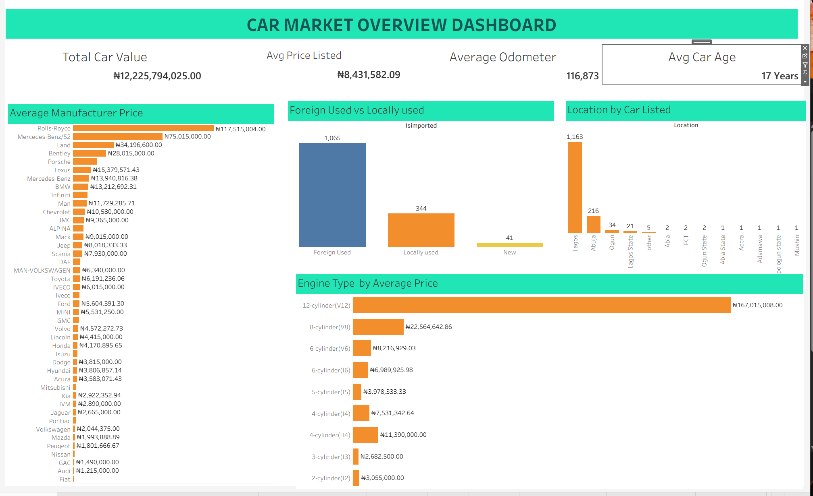
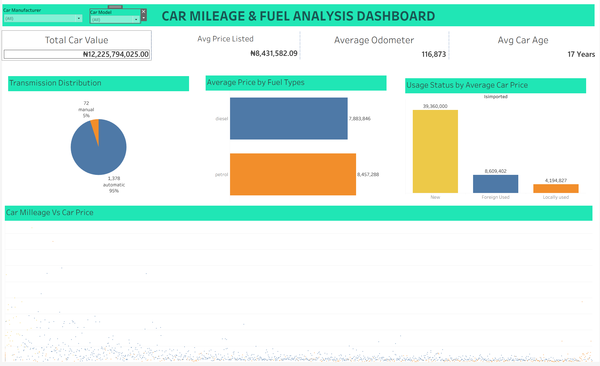
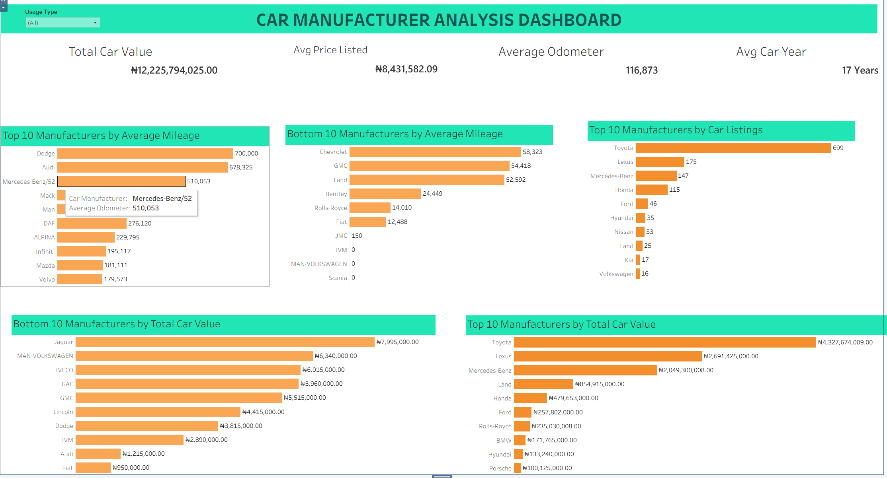

# Used Car Market Analysis

## Project Overview

This project explores the used car market using Excel and Tableau to understand vehicle listings, prices, mileage, manufacturers, fuel types, transmission types and usage status.

The analysis was carried out to identify patterns in car prices and listings, compare manufacturers, and understand how vehicle characteristics relate to market value.

## Tools Used

- **Microsoft Excel** – Data inspection and cleaning.
- **Tableau** – Data analysis, calculated fields, interactive dashboards and visualisation.

## Data Cleaning and Preparation

The dataset was first inspected in Excel. During the inspection, I identified one duplicate record for a Lexus RX 350. The duplicate had the same values across all columns, so I removed it before importing the cleaned dataset into Tableau.

After importing the dataset into Tableau, I explored the available fields, identified relevant business questions and created the KPIs needed for the analysis.

## Key Performance Indicators (KPIs)

- **Total Car Value:** NGN 12,225,794,025.00
- **Average Price Listed:** NGN 8,431,582.09
- **Average Odometer:** 116,873
- **Average Car Age:** 17 Years

*Total Car Value represents the combined listed value of the cars in the dataset, not actual sales revenue.*

## Dashboards

### 1. Car Market Overview Dashboard

This dashboard provides an overview of the car market, including average manufacturer prices, usage status, car listings by location and average prices by engine type.

**Key Findings:**

- Rolls-Royce had the highest average manufacturer price, followed by Mercedes-Benz/52, Land and Bentley. Fiat had the lowest average manufacturer price.
- Foreign-used cars had the highest number of listings (1,065), followed by locally used cars (344) and new cars (41).
- Lagos recorded the highest number of car listings (1,163), followed by Abuja (216) and Ogun State (34).
- 12-cylinder engines had the highest average listed price, while 2-cylinder engines had the lowest.

### 2. Car Mileage and Fuel Analysis Dashboard

This dashboard examines transmission distribution, average prices by fuel type, usage status by average car price and the relationship between car mileage and price.

**Key Findings:**

- Automatic transmission accounted for 1,378 cars (approximately 95%), while manual transmission accounted for 72 cars (approximately 5%).
- Petrol cars had a higher average listed price than diesel cars.
- New cars had the highest average listed price by usage status, followed by foreign-used cars and locally used cars.
- A scatter plot was used to examine the relationship between car mileage and listed price.
- Car Manufacturer and Car Model filters were added to allow comparisons between specific manufacturers and models.
- When filtered to Acura MDX, the results showed a general inverse relationship: cars with higher odometer readings tended to have lower listed prices.
- However, this relationship was not consistent across every vehicle. For example, a 2014 Lexus LX 570 with higher mileage was listed at approximately NGN 110 million, while a 2018 model with lower mileage was listed at approximately NGN 58 million. This shows that mileage alone does not determine a car's listed price.

### 3. Car Manufacturer Analysis Dashboard

This dashboard compares manufacturers based on average mileage, number of car listings and total listed car value.

**Key Findings:**

- Dodge had the highest average mileage, followed by Audi.
- Toyota recorded the highest number of car listings, with 699 cars.
- Toyota also had the highest combined listed car value at approximately NGN 4.33 billion.
- Lexus followed with approximately NGN 2.69 billion, while Mercedes-Benz recorded approximately NGN 2.05 billion.

## Overall Key Findings

1. Foreign-used cars accounted for the largest share of the listings.
2. Lagos had the highest number of car listings.
3. Automatic transmission vehicles represented approximately 95% of all listings.
4. Rolls-Royce had the highest average manufacturer price.
5. Petrol vehicles had a higher average listed price than diesel vehicles.
6. Toyota recorded the highest number of listings and the highest combined listed car value.
7. Higher odometer readings generally corresponded with lower listed prices, although individual models showed exceptions.

## Recommendations

- Marketplace operators should pay more attention to Lagos because it had the highest number of car listings, while also maintaining visibility in Abuja and Ogun State.

- Toyota, Lexus and Mercedes-Benz should be given priority when reviewing car listings and total listed values because they recorded the highest figures among the manufacturers.

- When comparing or pricing cars, consider mileage alongside the model year, manufacturer, model, fuel type and usage status. The Lexus LX 570 comparison shows that mileage alone does not determine a car's price.

- Since automatic cars made up about 95% of the listings, car marketplaces should make automatic transmission an important category in their search filters.

- Average price comparisons by manufacturer and engine type can help buyers and sellers understand price differences in the market. However, the number of cars behind each average should also be considered.

## Project Files

| File | Description |
|---|---|
| `Tableau/Used_Car_Market_Analysis.twbx` | Tableau workbook |
| `Report/Used_Car_Market_Analysis_Report.pdf` | Project report |
|

## Conclusion

The analysis provides an overview of the used car market by examining listed prices, vehicle mileage, manufacturers, fuel types, transmission types, usage status and locations.

The dashboards make it possible to compare vehicles and manufacturers, identify market patterns and explore how different vehicle characteristics relate to listed prices.

---
**Tools:** Microsoft Excel | Tableau
